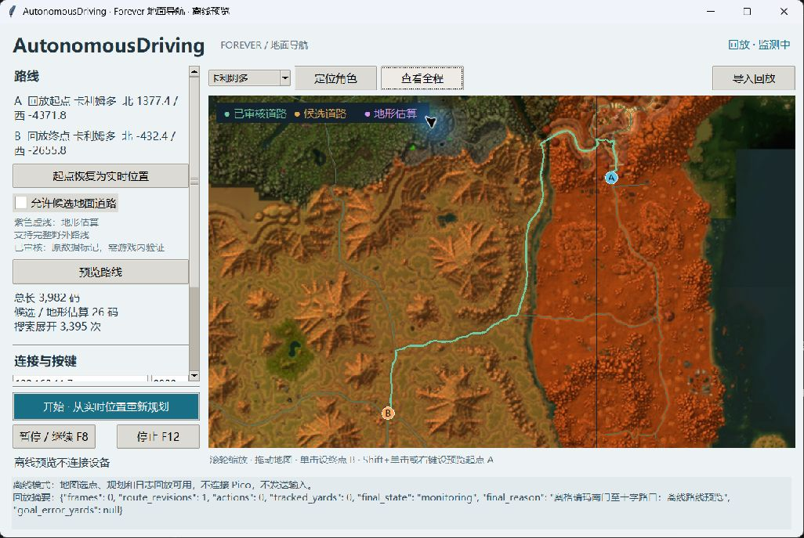
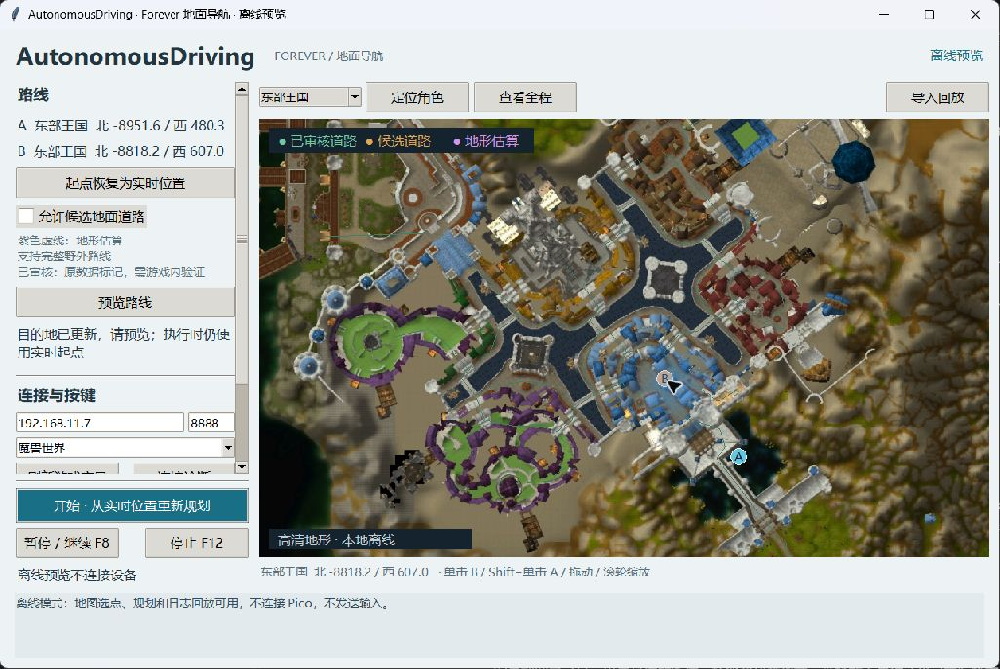
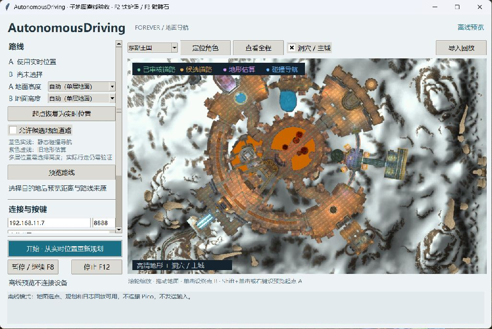

# 自动驾驶（Autonomous Driving）

首版已提供 **Forever 地面导航插件 + Windows 地图客户端**。在本机地图选择终点，客户端生成道路与野外混合路线，通过游戏色块观察位置，通过 Pico `hid_usb` 的 ADR v3 接口持续行走并纠偏。

运行时不依赖 MapWise、MyGpsBot 或 OpenMap 插件。三个参考目录保持原样，所需数据已提取到 `data/`。不检查游戏 build。



## 快速开始

环境：Windows、Python 3.15（含 Tkinter）。Pillow 13.0.0 安装在项目 `.venv` 内。**连续行走需要新固件 `hid_usb 0.5.0-lease`（ADR v3）**，源码在相邻的 `../hid_usb/` 项目。原 `b2d73c15` 固件可做旧健康查询，但不能启动新的连续控制。客户端不会自动退回无限按住。

固件构建步骤见 [本地编译环境](../hid_usb/docs/build-environment.md)。在本机 `../hid_usb/wifi_config.h` 填写 Wi-Fi 配置后运行该项目的 `scripts/build.ps1`，可联网产物为 `build-verified/hid_usb.uf2`。`build-compile-only/` 只验证编译，**不可刷入用于联网导航**。构建脚本不会自动烧录设备。

1. 将 `addons/AutonomousDriving` 文件夹复制到游戏的 `Interface/AddOns/`，在游戏插件列表启用它。停用旧 MyGpsBot，避免左上角色块重叠；参考插件不是必需依赖。
2. 双击 `start.cmd`。首次启动会创建项目环境并安装已锁定依赖。默认仅监测，不发送键鼠动作。路线规划和预览在独立进程计算，避免搜索占用采集、控制解释器；取消会结束对应规划进程。
3. 选择游戏窗口标题。Pico 默认地址 `192.168.11.7`，端口 `8888`；点击“连接诊断”只查询状态。
4. 在安全、空旷的室外位置，确认 W 是前进、A/D 是角色左转/右转。点击“原地转向校准”，切回游戏后保持鼠标键盘不动。程序会左右各短转两次；结果不一致会拒绝保存。改变游戏转向速度、按键或角色操作设置后重新校准。
5. 在客户端地图**单击设置终点 B**，默认起点是实时角色位置。点击“预览路线”；点击“开始”后切回游戏，程序从最新位置重新规划并开始。
6. **F8 暂停/继续，F12 停止**。切出游戏、进入聊天输入、异常状态或遥测过期都会停止；恢复后需要手动继续。

客户端设置区可滚动；开始、暂停和停止按钮固定显示。程序运行时需要游戏窗口可见、前台且色块未被遮挡。使用窗口或无边框模式；无法读取正确色块时不会开始。若快捷键被其他应用占用，会在日志中提示，请使用按钮。

```powershell
# 不接触设备的离线地图预览
./start.ps1 -Demo

# 自带样例回放；轨迹来自模拟，不是游戏实测
./start.ps1 -Replay examples/simulation.jsonl

# 真实数据生成的跨区路线预览（没有真实行走记录）
./start.ps1 -Replay examples/road-preview.jsonl

# 测试、重新提取数据
./start.ps1 -Test
./start.ps1 -Extract -Demo

# 只读设备/色块诊断，不发送输入动作
./.venv/Scripts/python.exe -m adrive.diagnostics --capture
# 新固件连续控制能力检查：仅查询，不开启按键会话
./.venv/Scripts/python.exe -m adrive.diagnostics --lease
```

## 地图与路线

- 滚轮缩放，左键拖动；单击设 B，Shift+单击或右键设预览起点 A。“起点恢复为实时位置”清除预览 A。“定位角色”和“查看全程”调整视图。
- 高清地图从本机 Forever 1.60.1.70658 的原始小地图贴图导出，东部王国 736 块、卡利姆多 988 块，每块 512×512。客户端自动读取 `data/maps-hd/manifest.json`，无需联网或运行游戏。近距离的原始线性分辨率是旧概览底图的 8 倍；超过原生精度后继续放大不会新增细节。
- 缩放围绕鼠标位置平滑过渡，按视野选取七级地图精度。图片后台解码、只绘制可见瓦片，已解码图片缓存上限为 96 MiB；拖动时复用图片。缺少高清包时仍可使用原有概览地图。
- 洞穴和地下主城子地图随放大渐显，与大陆底图、路线和选点共用世界坐标。当前包包含 248 个洞穴区域、31 张洞穴/入口主层地图，以及铁炉堡、幽暗城，554 张透明图片约 48 MiB。工具栏“洞穴 / 主城”可显示或隐藏；鼠标位于小洞穴上时可继续深入放大，最高 32 像素/码。图片不会凭放大增加原生细节。
- 子地图复用 OpenMap 的定位、旋转、透明裁剪和主层选择规则，图片从本机 1.60.1.70658 导出；WMO 定位表源自 OpenMap 1.60.1.70245，两个来源分别记录，没有把旧定位表冒充当前版本重新生成。子地图只影响显示，不改变精细碰撞导航或自动替用户选择楼层。详情见 [子地图说明](docs/submaps.md)。
- 预览可选择任意 A/B；实际执行始终重新读取角色位置。任务待执行或行走期间不允许改画其他起终点；修改候选策略会暂停当前任务。
- 蓝色是新接入的静态碰撞导航路线。绿色和橙色表示原有已审核/候选道路，紫色虚线表示旧地形估算。
- 已生成 Forever 1.60.1.70658 的精细导航包：东部王国 736 块、卡利姆多 988 块，约 947 MiB。客户端自动读取 `data/navigation/manifest.json`，用游戏 ADT 地形和 WMO/M2 碰撞规划完整步行路线。生成单元约 0.267 码，角色半径约 0.533 码、最大台阶约 0.533 码；这些是建网参数，不是实测行走误差。
- 原有道路作为偏好，路径仍须通过碰撞网格。不可达的道路参考点会跳过并寻找完整替代路线；不会把旧道路或直线当成可穿墙连接。排除水域、陡坡和跳跃/跨隙连接，不自动移动用户的起终点坐标。
- A/B 有多层地面时，在侧栏选择对应高度。实时执行使用插件报告的角色高度；需要更新本项目 `addons/AutonomousDriving`（0.2.0）并在游戏内重新加载。缺少高度时精细路线停止，不猜测角色楼层。
- 支持大陆 0、1 的已提取静态表面及其多层高度；不支持跨大陆、副本、动态门/电梯/船只和怪物避让。缺少可通行表面、无完整路径或超出预算时明确报错。导航包缺失时保留旧道路/粗网格兼容模式；已配置的导航包损坏时不静默退回旧模式。

地图底图与世界坐标同源；已提取 **10,035 个节点、7,027 条边、1,724 个地形块、152 张底图及 52 个地图框**。道路边中包含被保留但不参与首版寻路的交通类型。原数据审核标记不代表本项目已实测；约 16.7 码的地形网格不能保证精细避障或避开怪物。

上述 152 张是保留用于兼容的旧概览图。高清图片包和精细导航包分别存放，重新运行 `tools/extract_data.py` 不会覆盖它们。图片精度与碰撞精度分别校验；运行时不检查游戏安装版本，游戏更新后应重新导出或核对资源。新导航的来源、构建方式与限制见 [精细导航说明](docs/navigation.md)。





## 输入与异常处理

每条直线先对齐至 3°以内再前进；朝向偏差超过 5°、横向偏差超过 3 码时重新对齐，偏离超过 15 码时重规划。长直线保持 W，约每 50 ms 根据新遥测续期，不再每 200 ms 松键。转向和接近拐点使用 20–200 ms 短动作，设备到时释放；续期不重启短动作，观察释放后的新画面再继续。速度根据遥测及实际位移修正。

累计前进指令两秒但位移不足 0.5 码时阻断失败连接，任务内最多重规划两次。旧路线到达终点 2 码范围后停止。精细路线采用 0.3 码中间点、0.6 码终点容差，并检查高度；横向偏离超过 0.75 码即重新规划，楼层不符时停止。不自动跳跃、随机脱困或施放坐骑。

战斗、死亡、游泳、飞行、鸟点、加载、位置无效、插件重载、输入框焦点、设备失联或窗口失焦都会停止。船/电梯检测仅使用客户端实际可用的运输 API，不能保证识别所有类型；首版不规划这类交通。

ADR v3 带设备启动标识、会话、序号和状态回应。持续状态不排队；停止抢占当前控制并撤销会话。重复或迟到的数据包不能恢复旧会话。客户端超过 180 ms 没有新的有效确认就停止续期；固件默认 250 ms 租约到期独立释放。通信使用非阻塞轮询，不再因一次 120 ms 健康查询无回应而阻塞行走监测。

截图与解码在独立工作线程执行，控制循环只读取最新采样；迟到或重复画面不会刷新有效时间。B/W/A/S/D 不属于暂停快捷键。若发生停顿，日志会区分客户端循环延迟、未及时续期与未收到状态确认，避免把所有停顿都称为 Pico 查询超时。修改客户端后需关闭旧窗口并重新运行 `start.cmd`，已有 ADR v3 固件无需为这项修订重新刷入。

控制循环使用可中断的高精度等待：UDP 回应、新遥测及停止请求到达时直接唤醒，不再等下一轮固定轮询。续期到期时间单独安排，早到的有效新帧只可授权一次续期，不会因重复唤醒不断延长输入。180 ms 确认期限仍在读取积压回应之前检查；不改变系统全局定时精度或线程优先级，也不新增控制报文。日志的 `previous_wait` 记录实际等待与超出时长，状态事件同时记录设备时间和本机处理时间。

接收确认与 USB 提交确认分别记录；续期不能冒充丢失按键状态的提交确认。USB 接受报告仍不代表游戏已执行，实际效果依靠位置和朝向判断。运行期间应独占 Pico。实际释放和游戏停止延迟仍需刷入新固件后实测。

固件 `0.5.1-diagnostics` 增加明确的停止原因与时间、键盘报告提交/USB 完成/释放时间、版本与能力范围，以及网络发送失败、USB 错误和两核主循环最大停顿计数。客户端“连接诊断”显示版本与兼容性，详情写入运行日志；停止后也会自动读取一次诊断。事件带会话身份及有效标记，缺少完成证据时显示“无可关联记录”，不会当作 0 ms。时间戳精度为 1 ms，USB 完成仍不代表游戏已处理。

扩展诊断使用独立只读请求和独立连接。行走/校准期间不发送扩展诊断、不增加控制报文、不等待诊断完成；原 40 字节控制请求、48 字节回应、USB 轮询间隔和 180/250 ms 保护保持不变。旧 ADR v3 固件仍可控制，但显示“扩展诊断未提供”；要使用新诊断需手动刷入新固件，然后重启客户端并点击“连接诊断”。也可在暂停后保存只读诊断：

```powershell
.\.venv\Scripts\python.exe -m adrive.diagnostics --firmware --count 1 --output runtime\firmware-diagnostic.jsonl
```

配置在 `runtime/config.json`，运行记录在 `runtime/logs/*.jsonl`，都已加入忽略规则。记录包括遥测、路线修订、动作、状态确认、查询往返耗时及停止原因，可通过“导入回放”查看；回放窗口不会连接设备。

## 开发与验证

```powershell
./.venv/Scripts/python.exe -m unittest discover -s tests -v
./.venv/Scripts/python.exe -m adrive.simulation --pixels --output runtime/simulation.jsonl
./.venv/Scripts/python.exe tools/extract_data.py
```

重新导出高清地图（需要本机游戏文件；导出过程只读游戏目录）：

```powershell
# 首次准备提取工具：需要 CMake 和 Visual Studio C++ Build Tools。
# 下载固定提交的官方 CascLib 源码，在 runtime/map-tools 内编译。
./tools/build_casc.ps1

# 从当前安装版本的 WDT 索引提取两大陆 BLP，生成无损 WebP 和概览层。
# 首次获取对应版本 Map CSV 时联网；后续客户端显示完全离线。
./.venv/Scripts/python.exe tools/export_maps.py --game-root 'C:\Program Files (x86)\World of Warcraft'

# 校验全部图片、摘要与原始 WDT 瓦片覆盖；离线重绘性能测量。
./.venv/Scripts/python.exe tools/check_maps.py
./.venv/Scripts/python.exe tools/benchmark_map.py
```

每次导出写入单独版本目录，成功后才替换高清包清单。缺失、损坏或未能解码的游戏资源会使导出失败，不发布残缺包。清单保留客户端版本、WDT 与原始 BLP 摘要、导出图片摘要和工具版本，游戏美术的版权说明在 `data/maps-hd/NOTICE.txt`。

重新导出洞穴、地下主城子地图（复用同一个 CASC 读取库及本地 OpenMap 参考数据）：

```powershell
./.venv/Scripts/python.exe tools/export_submaps.py
./.venv/Scripts/python.exe tools/check_submaps.py
./.venv/Scripts/python.exe tools/benchmark_map.py --submaps
```

子地图独立存放于 `data/submaps/`，生成失败不会替换当前包。透明图片与底图共享 96 MiB 解码缓存，另有上限 32 MiB 的子地图显示缓存，复用平移时的像素取整变体，避免接缝和重复缩放。

重新构建精细导航（使用本机 WSL Ubuntu 内现有 Forever 工具，输出全部留在本项目）：

```powershell
./tools/build_navmesh.ps1
./.venv/Scripts/python.exe tools/export_navigation.py
./.venv/Scripts/python.exe tools/check_navigation.py
```

项目已在 [AGENTS.md](AGENTS.md) 记录现有 Forever 源码、工具和数据位置；后续地图与寻路工作优先核实并复用这些资源。不会覆盖正在运行的服务端数据。提取器与客户端读取库的版本需要匹配，详细参数见 [精细导航说明](docs/navigation.md)。

生产依赖在 `requirements.txt`。可选的 `requirements-dev.txt` 提供 Lupa，用真实 Lua 5.1 离线执行插件；未安装时这组测试明确显示 skip，不能算作已通过。Python 3.15 安装 Lupa 可能需要本机 C++ 编译环境，见 [Lua 测试说明](docs/telemetry-protocol.md)。

实现结构：`adrive/` 为数据、寻路、色块、截图、设备、控制、运行循环和桌面界面；`tools/` 为数据提取；`tests/` 为离线测试；`examples/` 为回放样例。细节见 [色块协议](docs/telemetry-protocol.md)、[连续控制协议](docs/pico-v3.md)、[旧 Pico 协议背景](docs/pico-protocol.md)、[验收记录](docs/validation.md)。

所有源文件摘要和原始审核状态保留在 `data/sources.json` / `data/bundle.json`。底图为原有 Blizzard 游戏美术，不属于 OpenMap 的 MIT 许可；随附来源与许可保留在 `data/notices/`。

## 原始设想与后续目标

以下保留项目最初需求；飞行、游泳、复活、开鸟点与路线编辑属于后续版本。

---
利用游戏内的角色坐标和朝向的图色读取，搭配已有的路径计算的插件，用pico2w来操作输入。制作一个自动驾驶插件。

架构：游戏内插件+本机客户端。

思考点：查看完路径计算的插件的代码后，再判断路径生成在游戏中做还是客户端做。

思路：

1. 学习已有的路径计算插件或网页，把数据全部提取出来，首先要实现一个A点到B点的路线生成。
2. 一直读取自己的坐标和朝向，使角色始终保持在路线上不脱离。
3. 移动和视角的调整，通过精密算法计算后，发送给pico2w输入信号。
4. 要有自动纠错的机制，如果发出的信号没有使角色保持在路线上，则立马计算修正的指令。

进阶思路：

1. 要对游戏中角色是否进战斗和死亡，掉线等特殊情况进行监控。
2. 支持飞行，和游泳。并且记录已经解锁的鸟点，
3. 可以与灵魂行者对话复活，然后重新计算路线。
4. 支持开鸟点。
5. 支持移动速度变化导致的重新计算。
6. 同时再制作一个工具可以自己画新的路线，可以实现自定义。

算法：

1. 首先计算起点和终点的路线，选择最短的，最安全的。路线可以结合跑，飞，游3中方式。
2. 然后分解路线为x个跑路直线和y个飞行路线和z个游泳路线。
3. 对于跑路路线，分解为一堆子路线，子路线为直线，起始点，直线，终点。终点可能是需要转向的拐点，NPC坐标，最终终点。
4. 然后把每一个分解完的子路线结合角色当前朝向，坐标，移动速度.计算出键盘需要的操作。键盘可以控制角色的wasd移动和自身顺时针或逆时针转向。默认每个子路线先调整转向，再开始移动。


