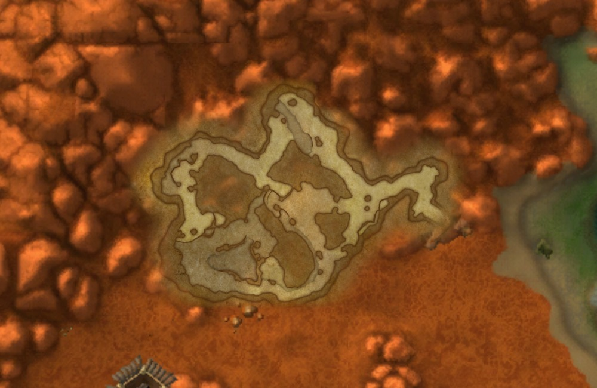

# 洞穴、地下主城的无缝子地图

客户端将洞穴和地下主城绘制为大陆地图上的透明图层。缩放和平移使用现有世界坐标变换，起终点、角色位置和路线不随显示图层切换而改变。工具栏“洞穴 / 主城”默认开启，可临时隐藏。

子地图按占据视野的比例平滑渐显，远景隐藏；近景由高清瓦片替代概览瓦片。小洞穴允许继续深入放大，缩放仍固定鼠标下的世界坐标。最高 32 像素/码只是查看上限，并不增加原图细节。默认显示 OpenMap 的主层：不会把黑石山的更深楼层同时盖到主层上。三维寻路所需的 A/B 高度仍由现有高度选择器处理。

## 数据和来源

本次导出共 281 个区域：248 个 WMO 洞穴区域、31 张洞穴/入口地图、铁炉堡和幽暗城两座地下主城。共 554 张透明无损 WebP，50,218,962 字节（约 47.9 MiB）。全部图片读取自本机 `wowf 1.60.1.70658`；游戏和服务端目录保持只读。

定位与组合参考本地 OpenMap v0.7.5-beta：

- `Data/CaveMinimap.lua`：WMO 图片的文件编号、世界中心、尺寸、旋转角及 UV 范围，包含两座地下主城。
- `Data/Caves.lua`：洞穴和入口地图的世界边界、12 张原生地图拼片。
- `Map/Close.lua`：透明裁剪、最低层先绘制以及主层选择规则。
- `Media/Textures/MapCave/`：洞穴地图边界蒙版。

WMO 定位表标注来源版本 1.60.1.70245；当前游戏图片与参考定位版本分别记入清单。本次没有从 70658 WMO 几何重新生成定位表，因此不能宣称所有坐标已按新版本重新核验。当前铁炉堡布局和原生图片拼接经过离线视觉检查；仍需在游戏中确认洞口、特殊区域和层级关系。

`data/submaps/manifest.json` 指向版本目录。每张导出图片、每个当前客户端输入资源、参考源码及蒙版都有摘要；参考文件、MIT 许可和原美术版权说明保存在版本目录 `sources/`。代码许可不代表拥有游戏美术的再分发权。

## 实现

`tools/export_submaps.py` 只读游戏 CASC，按参考文件编号导出原图。WMO 图片应用准确的中心旋转和 UV 裁剪：超出 UV 0..1 的部分透明，不能重复平铺或拉伸边缘。洞穴地图由 4×3 原始拼片裁成 1002×668，再应用透明蒙版。输出统一拆成 512×512 瓦片并建立概览层；先填充透明边界再降采样，保持每一级的世界像素间距。

`adrive/submaps.py` 管理世界边界、可见区域和渐显比例。`MapView` 在大陆瓦片上、路线下绘制子地图。同一区域同时只使用一个已准备好的清晰度层，避免把同一幅透明图叠两次产生重影。相邻瓦片共享取整边界，避免透明接缝重复混合。

图片后台解码与底图共用 96 MiB 缓存；另有最多 32 MiB 的显示缓存，复用平移时宽高相差一像素的图片。超大倍率先裁剪到视口附近再缩放，不创建覆盖整座城市的超大显示图片。子地图缺失或无法读取时保留大陆底图并显示不可用提示。

```powershell
./tools/build_casc.ps1
./.venv/Scripts/python.exe tools/export_submaps.py
./.venv/Scripts/python.exe tools/check_submaps.py
./.venv/Scripts/python.exe tools/benchmark_map.py --submaps
```

前两步用于重新构建资源；已附带当前子地图包时直接重启客户端即可使用。导出在完整图片和摘要校验通过后才替换活动清单；`tools/extract_data.py` 不覆盖子地图包。

## 本轮验证

- 全部 554 张图片尺寸、摘要、透明度，以及保留的参考源码和蒙版摘要通过校验。
- 自动测试覆盖正向旋转、超出 UV 范围的透明处理、透明填充、概览层像素间距、坐标变换、逐级渐显、深度缩放鼠标锚点、错误清单拒绝及显示图片缓存复用。
- 本轮完整项目离线测试 275 项通过，无跳过；Python 编译检查通过。
- 实际离线窗口中看到铁炉堡室内地图叠加在雪山区域上；没有连接 Pico 或发送游戏输入。截图如下。
- 1100×720 离线 Tk 视口、缓存预热后的 60 次微量平移：铁炉堡近景中位 5.09 ms / P95 8.79 ms，细节视图 4.10 / 5.62 ms；骷髅石 2.72 / 4.33 ms；小洞穴深度视图 3.55 / 5.11 ms。解码失败 0；测试中原图缓存最高 49 MiB，子地图显示缓存最高 23.7 MiB。这不是显示帧率保证，不代表冷加载或每次缩放动画耗时。


下图是按客户端相同世界坐标和透明度规则生成的骷髅石离线合成图，不是游戏截图。



本功能改善地图显示，不增加副本导航、动态障碍识别或自动楼层判断，也不把离线拼接验证当成真实行走验收。
