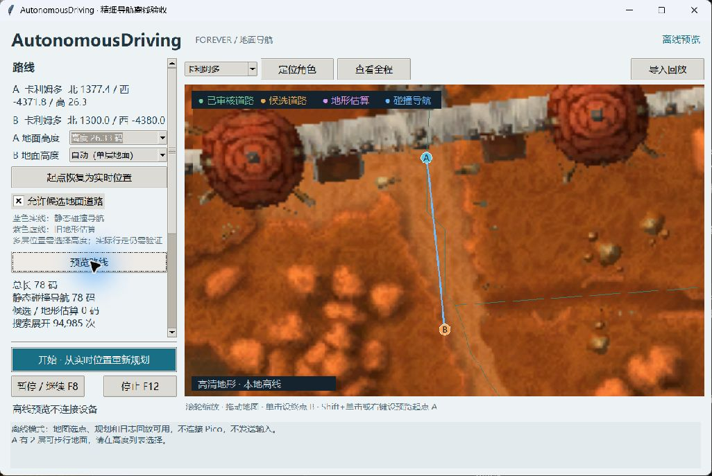

# 首版验证与实机验收

离线测试、设备通信和真实游戏行为分别记录。

## 连续运动与时间序列（2026-10-30）

新默认模式为 AD 遥测 v4 + ADRV v4。当前速度逐帧读取；地面能力、零速度、未知值分别处理。新增相切弯道、组合移动/转向/平移、一次性走路切换、局部单调进度、带楼层的 native 走廊与整段扫掠验证；运动计算在独立进程。见 [实现和实机步骤](continuous-motion.md)。

完整 Python 离线回归 431 项通过（无跳过），包含生产 Lua 5.1 插件、Python→生产 C 固件互通、跨瓦片/双层地面/墙/水、独立运动进程、停止竞态和窗口时效。生产 C 引擎、Wi-Fi、桥接、租约和诊断五套测试通过。正常直行/左右弯/S 弯/回环仿真不出现全释放或原地转向，回环弯道横向误差 ≤0.3 码，终点 ≤0.6 码；另测速度改变、平移、坡道和窄弯切换。测试输出中的失败拓扑夹具是预期的拒绝测试，不是活动包回归失败。

实际桥梁源路线中有接缝点不能被严格“点在面内”重新识别。运动走廊采用限定的接缝拓扑识别与有预算的连接搜索；实际运动仍使用严格定位和正净空，不放宽半径或水过滤。六条桥梁正反向运动 ABI 检查通过；这不代表这些桥已被新控制器实机走通。

最终 DLL SHA256：`fab4b0128ab823959d756633de719f0580c0d6b04bd2398ae3d12bae053af9da`。导航身份仍为 `7a4606dd9c967264`，1,724 个瓦片字节未变，monotone、water=false。道路身份为 `e2cdc40b5ba3bab9`，32,939 条边全部重新绑定和验证。候选及发布后的活动永久导航/道路门禁均 `passed / FAILURES=0`，报告位于 `runtime/motion-release/`。

可部署固件 `hid_usb 0.6.0-motion` 使用锁定 SDK 2.3.1 和已有本机 Wi-Fi 配置构建，UF2 SHA256：`39a15b0b1227db5dc437994b9e38645a207de26eb845b4a373153cc040d0e23f`。没有刷写、没有发送真实游戏输入。真实 Forever API 返回值、板上 USB/Wi-Fi 时序、地面坐骑和最终走路效果仍需按实机步骤验收。保留 180/250 ms 保护，没有扩大超时或增加固定动作等待。

## 重启后规划阶段遥测过期（2026-10-29）

`20261029-053504-748425.jsonl` 共记录 8 次 250 ms 遥测暂停，首轮规划开始于 77.519 s、暂停于 79.066 s。当时采集样本年龄达到 365.9 ms；后续一次截图耗时 235.8 ms，包含窗口查询、截图多个阶段延迟。控制线程也出现显著迟延。这证明客户端采集/处理链路有停顿；日志不能单独证明全部时间由 GIL、系统调度或图形驱动中的哪一个造成，不能归因于键鼠与 Pico 冲突。

正式规划和预览改为独立进程，数据加载、Python 搜索与原生搜索不再共享采集/控制解释器。监督线程处理取消，终止并回收子进程；保留错误原因、原始终点、展开预算。规划器构造也移出控制线程。180 ms 确认、250 ms 遥测、50 ms 最小续期间隔不变，无新增动作等待；独立进程会增加路线生成的启动开销。

`tools/check_planning_isolation.py` 为无设备离线对比：使用本地真实规划数据，同时循环执行 Win32 只读调用与 5 ms 等待。每组 3 秒，旧线程规划监测循环最大 37.57 ms，新进程规划最大 6.32 ms，中位均约 5.52 ms，P95 均约 5.64 ms。结果保存在 `runtime/planning-isolation-probe.json`。两组均未复现 180/250 ms 超时，不作为游戏内修复验收。

完整回归 273 项通过；随后增加启动前高度检查，相关 30 项通过（含新增测试）。覆盖独立进程路线往返、原始终点、错误码、指定数据路径、取消未响应子进程与回收、提前取消不启动进程。首次受限测试中的两个回环 UDP 用例被运行环境阻断，正常本机环境复跑通过。未发送真实游戏动作。

`20261029-054630-150396.jsonl` 另有缺少角色高度、精细导航预算和终点不在可步行表面的错误。缺少高度现在在进入运行状态之前拒绝；游戏端仍需安装项目 `addons/AutonomousDriving` 0.2.0 并重新加载。此项不能靠更新 Pico 固件解决。修改后的客户端实际导航尚待重启后验证。

## 键鼠操作与客户端等待修订（2026-10-29）

检查 `20261029-045927-162420.jsonl`：控制循环经常约 31 ms 一轮，实际工作多数低于 1 ms；故障附近也有 83–84 ms 的循环间隔，而同轮工作约 1.5–2.3 ms。原 `threading.Event.wait(1/60)` 的本机 50 次测量中位数约 33.8 ms，并出现 181 ms 等待。该结果确认客户端存在等待/调度迟延，但不能单靠历史日志区分全部无线迟延与收包调度；旧日志没有保存迟到回应的设备时间，也没有实体按键时刻。

修复：新增 `LoopWaiter`，用 Windows 高精度一次性定时器、命令事件和 UDP 可读事件共同等待；由同一个控制线程读取/校验回应，不增加独立续期线程。截图线程改用相同精度的等待，有新样本时唤醒控制线程；停止命令立即唤醒。续期间隔到期可以使用此前已到达但尚未用于续期的新帧一次，避免再等下一张图；相同帧不得重复授权。等待时间同时受确认截止和遥测有效期限制。保持 180 ms/250 ms 门限、迟到积压回应拒绝、设备定时动作、50 ms 最小续期间隔及全部停止检查，不设置全局 timeBeginPeriod、实时优先级或忙等。固件无需重新刷入。

用户配合的只读对照：`tools/check_input_latency.py` 先确认 Pico 没有活动输入会话，再交替使用原等待和新版唤醒读取 op5，不发送 OPEN/SET/RENEW/STOP。约 30 秒共 451 次查询，捕获 W/A/S/D 和左右鼠标按钮及移动标记。只采样这些指定输入的合并状态，不记录文字，不识别物理设备；短按可能漏过。

| 条件 | 原等待次数 / 中位 / P95 / 最大 ms | 新唤醒次数 / 中位 / P95 / 最大 ms |
| --- | --- | --- |
| 未捕获键鼠活动 | 78 / 22.99 / 37.62 / 95.41 | 78 / 1.86 / 12.29 / 60.18 |
| 捕获键鼠活动 | 148 / 21.31 / 34.95 / 53.34 | 147 / 1.97 / 7.92 / 21.28 |

所有查询有效、无 180 ms 超时，网络/USB 错误计数均保持 0。结果在 `runtime/input-latency-probe.json`，证明这一轮键鼠操作没有使 Pico 诊断通信失效，且客户端固定等待显著放大回应处理延迟。第二轮 15 秒查询保存在 `runtime/input-latency-b-probe.json`，未捕获 B；用户明确不要求单独验证 B，因此不把它写成 B 键通过。两轮均为只读查询，不能证明自动行走时键鼠不会叠加影响角色，也没有复现并逐包定位历史 180 ms 故障的全部来源。

完整回归 **256 项通过，0 跳过**，包括 8 项新增调度/续期测试，以及原有迟到回应不得恢复、冻结不续期、失焦/战斗/停止竞态检查。新增 UDP 测试仅连接 127.0.0.1，验证可读事件不消费报文、重置后不忙循环、替换连接不继承旧事件；命令信号可中断长等待。受限网络环境最初阻断了两个本地 UDP 用例，允许本地网络后通过。Python 编译与差异格式检查通过。

实现依据：[高精度等待定时器](https://learn.microsoft.com/en-us/windows/win32/api/synchapi/nf-synchapi-createwaitabletimerexw)、[UDP 可读事件](https://learn.microsoft.com/en-us/windows/win32/api/winsock2/nf-winsock2-wsaeventselect)、[事件原子清除](https://learn.microsoft.com/en-us/windows/win32/api/winsock2/nf-winsock2-wsaenumnetworkevents)。Windows 调度仍非实时保证。新客户端实际导航仍需关闭旧进程、重新启动后复测；不能把只读结果等同于整条路线验收。

## 固件扩展诊断与延迟回归（2026-10-29）

固件 `0.5.1-diagnostics` 与客户端同步加入停止原因/时间、键盘报告提交/USB 完成/零释放事件、固件版本与协议/能力范围，以及网络发送失败、USB 异常和两核最大循环间隔计数。事件记录设备启动标识、被撤销/提交时的会话身份及有效位；重复 STOP 不覆盖首次原因，迟到 USB 完成不会借用新会话身份。无法可靠匹配完成时记录异常并保持未知，不伪造 0 ms。

控制请求/响应仍为 40/48 字节，USB 描述符轮询间隔仍为 1 ms，续期及 180/250 ms 保护不变。扩展查询单独使用 40/160 字节，只读且不续期、不产生 USB 报告。客户端诊断 socket 与控制 socket 分离，仅手动诊断或停止后查询一次；自动查询等待停止后 350 ms、间隔至少 5 秒，开始/校准时取消，运行中不发送扩展诊断。诊断失败不覆盖原停止原因，不延迟控制或作为控制确认。固件使用定长内存记账，复用原有 publish/heartbeat 锁；时间换算和诊断响应编码均在锁外，无新增 Flash 写入、动作队列或主动等待。

验证结果：

- 客户端完整测试 **237 项通过，0 失败、0 跳过**。包括 25 项新诊断/CLI/UI/运行循环测试及新增互通测试；生产固件 C DLL 互通共 10 项实际执行。完整测试外层禁止未替换的真实 socket，确保不会访问实际 Pico。后续中文详情补充单独重跑 25 项通过。
- 固件 **36 组生产 C 主机测试、27 项 Python 回归通过**。覆盖只读查询、格式、提交/完成分离、跨取消/会话回调、失败/拔线/跟踪覆盖、首次停止原因、计数/时钟回绕与短动作释放。
- Python 编译和两个仓库的差异格式检查通过。测试完成后再次使用锁定工具链交叉编译 Pico 2 W / RP2350 Release 成功，保留本机 Wi-Fi 配置；未刷机、未发送实机输入。

最终主机 DLL `1ca4b812df495efaca41f42ea906bcac8c1290ad8bab8c489f9665b10f8822e2` 与旧版对比，各操作 7 轮交替、共 21,000 次。单位为微秒：

| 操作 | 旧版 p50 / p95 | 新版 p50 / p95 |
| --- | --- | --- |
| SET | 1.9 / 3.8 | 1.9 / 4.3 |
| RENEW | 1.9 / 3.5 | 1.9 / 4.1 |
| STOP | 1.9 / 4.1 | 2.0 / 4.3 |

新版计入显式完成回调后，SET/STOP p50 为 2.9/3.0 微秒；Core1 记录函数主机调用 p50/p95 为 0.6/0.8 微秒。RENEW、诊断、heartbeat 不增加 USB 报告，测试适配器内 SET/STOP 每次各一份。保留全部分轮、最大值与摘要于 [基准原始结果](firmware-diagnostics-benchmark.json)，复跑工具为 `tools/benchmark_lease.py`。结果包含 ctypes 调用与 Windows 调度；同 DLL 自对照也有波动和长尾。这些数据不能作为板上绝对零开销、无线/USB 往返或游戏响应延迟保证，实机需刷入后核验。

可刷入产物：`../hid_usb/build-verified/hid_usb.uf2`，SHA256 `e73d3219eabf48a16a1be019fd9debc2d2418d92b48be872f7ab85f969e97556`。构建清单标记 `compile_only=false`、`deployable_configuration=true`。旧 UF2 和清单保存在 `../hid_usb/backups/pre-diagnostics-20261029-045812`。

用户手动刷入后，重启客户端并点击“连接诊断”，应显示固件 `0.5.1` 及 ADR `3–3`。随后分别实测正常行走、暂停、租约到期、网络/USB 异常，核对原因、计数和可关联的释放时间。时间戳粒度 1 ms，USB 完成仍不能替代游戏遥测。

## 实体键盘操作附近的 180 ms 停止（2026-10-29）

用户报告按 B 打开背包、偶尔按 W/A/S/D 后暂停，游戏没有失去前台。检查 `runtime/logs/20261029-041406-756275.jsonl`，最近三次行走停止均为 180 ms 确认保护；当时遥测 flags=1，没有失焦、输入框焦点或战斗停止记录。程序只将 F8/F12 注册为暂停/停止键，没有普通 B/W/A/S/D 按键触发暂停的逻辑。

| 日志相对时间 | 证据 |
| --- | --- |
| 576.1589 s | 575.9667 s 已确认续期序号 237，此后没有新续期；192 ms 后停止。已发状态全部收到确认。 |
| 784.3872 s | 最近续期 2059 发出仅约 77 ms，因距上一确认约 192 ms 而停止；784.4628 s 又读到该续期的成功回应。应用层往返耗时 153 ms，包含客户端轮询延迟，不能单独当作无线链路延迟。 |
| 821.9102 s | 821.6039 s 已确认续期 226；下一条成功遥测直到 821.9095 s 才记录，采样开始时间也相隔约 307 ms，期间没有新续期。插件序号 18189→18198，仍在推进。 |

这些日志说明续期/回应处理不及时，不能证明实体键盘直接取消 Pico 输入，也不能进一步区分采集失败、GDI/解码阻塞、界面/日志耗时与线程调度。原实现把截图与解码放在同一个控制循环，存在慢采集推迟通信处理的路径。

客户端修订：采集与解码在独立工作线程运行，控制线程只读取最新结果；保留原采样时间、250 ms 新鲜度检查和只基于新遥测续期。地图将连续轨迹合为折线，每批界面事件只绘制一次。停止保护仍为 180 ms，固件租约仍为 250 ms；超时日志区分控制循环迟延、未继续续期和未确认状态，并保留停止前的确认/发送年龄及序号。

本次修订后工作区完整自动测试 212 项通过，0 失败、0 跳过，包括 6 项生产固件 C 互通测试。新增检查覆盖采集持续阻塞时仍轮询/停止、冻结不续期、迟到帧不重置采样时间、前台变化、工作线程独占资源关闭、慢日志/窗口检查后的时间复核、实际发令时再次检查 180 ms 确认期限，以及窗口检查阻塞期间仍可登记停止且随后不再发送按键或续期。处理设备回应前也检查原确认期限：轮询间隔 206 ms 后读到积压的成功回应，仍停止且不允许续期，不用迟到回应掩盖停顿。Python 编译检查及 `git diff --check` 通过；没有发送实机输入。`runtime_timing` 和错误事件记录采集阶段与控制循环耗时，供下次实测区分阻塞来源。

轨迹绘制的本机 Tk 对照测量（1500 个点、各 20 次、不连接设备）：旧路径约 12.07 ms/次，修订后约 1.50 ms/次。此结果仅说明界面开销下降，不证明它就是先前 306 ms 空档的唯一原因。用户需要重启客户端后重测 B/W/A/S/D；本轮不修改或重刷固件。

## 首次游戏测试及连续控制修订

用户已实际加载插件、校准并尝试行走。日志 `runtime/logs/20261029-034304-581608.jsonl` 中，读取时有 4 次行走、63 次非校准按键，4 次均在动作观察阶段查询超时。连续 W200ms 的发令间隔中位数 280.88 ms，即名义松键间隙约 80.88 ms；该间隙来自原客户端逐次松键再观察的设计。旧查询超时固定 120 ms，单个查询无回应就故障。日志没有逐查询 RTT，因此未证明这些超时是固件故障或 Wi-Fi 断线。

第四次末尾 t=575.0507 发出 W200ms，t=575.2224 查询超时并请求释放，t=575.249 遥测速度仍为 7，t=575.290 才为 0。不能把释放报文发出当作游戏已经停止。

这次修订增加 ADR v3：持续完整键状态、独立续租、短动作限时、会话撤销、序号去重和非阻塞状态轮询。客户端默认需新固件；源码/自动测试和交叉编译不能替代新固件刷入后的实机复测。先前“没有游戏窗口”的记录仅指首版开发时的诊断，不代表用户随后没有运行游戏。

连续控制修订验证：

- 客户端 183 项自动测试全部通过，无跳过；包括连续控制/校准/运行循环测试、异步租约通信测试，以及 6 项直接连接生产 C 状态机的 Python 互通测试。
- 模拟 4 秒直线只设置一次 W，后续仅续期；包含连续拐点、速度变化、丢 SET 而收到 RENEW、丢 ACK、冻结、失焦、战斗及停止竞态。短动作结束后等待真实零状态及新的后续遥测；校准也使用新协议。
- 固件真实生产 C 主机测试 30 组通过，原 Python 回归 27 项通过。互通 DLL 复用生产 bridge/lease/engine；模拟 USB 接受报告，不产生实际 USB 输入。
- 官方工具链在 `../hid_usb/.tools` 固定到 Pico SDK 2.3.1、Arm GNU 15.2.Rel1、CMake 4.3.4、Ninja 1.13.2。真实 Pico 2 W / RP2350 交叉编译成功，使用本地 Wi-Fi 配置生成 `../hid_usb/build-verified/hid_usb.uf2`。
- 联网固件版本 `0.5.0-lease`，SHA256 `316aecc220115e70a3e9eda98ffb44be7c07edddaaff3916e081144a761e1d36`；构建模式与摘要在同目录 `build-manifest.json`。本次没有刷板、没有发实机按键。

重建可选 C 互通测试先运行固件仓库 `scripts/build_host_lease.ps1`，再运行本客户端测试；其他机器缺少 DLL 时，这 6 项会明确跳过，不能计为已通过。安装新固件后，应重做连接诊断和原地转向校准，再测试短直线与暂停。

## 路边起点无法接入修复（2026-10-29）

- 复现输入：运行日志 `runtime/logs/20261029-034304-581608.jsonl` 的实际位置为大陆 0、北 `-8967.125`、西 `511.1875`；终点按用户截图转录为北 `-10543.9`、西 `-1192.3`。截图终点只显示一位小数，回归使用该精度。
- 原因：最近已审核地面道路 `road:4254` 只有 `2.180402` 码远，符合原来的 5 码接入限制；但角色网格 `(1562, 993)` 和道路投影网格 `(1561, 993)` 都带水域位，原逻辑要求接入全程为干地，因此直接拒绝。日志角色状态为 `VALID`，没有游泳标记。此处是道路数据与粗地形水域位冲突，并非道路距离超限。
- 修复范围：仅已审核地面道路的 5 码内起终点接入可忽略水域位；仍检查非零连通数据、有向连接及斜角阻挡。接入段标为 `terrain`，来源记录为 `reviewed road endpoint access estimate`，原始起终点、道路拐点与失败连接排除保持有效。野外搜索及道路到网格中心的连接继续排除水域。
- 修复前回归能重现起点和反向终点接入失败；修复后双向均生成 `4,264.612` 码、142 段路线，其中 140 段为来源标记已审核道路、2 段为端点接入估算。正向展开 841 次、反向 873 次。
- 验证：寻路测试 23 项通过；完整 `python -m unittest discover -s tests -v` 共 172 项通过、无跳过。新增检查覆盖近道路水域接入、起终点保持、审核状态、候选/非地面排除、距离上限、单向连接、缺失/阻塞网格、斜角阻挡和失败接入排除。
- 本次只读取既有运行日志并离线生成路线，没有发送游戏输入。该修复依赖已审核道路的近距离接入估算，不能区分桥上与桥下高度，也不代表实际碰撞或整条路线行走已验收。关闭旧客户端后重新运行 `start.cmd` 才会加载修复。

## 已执行

- 首版自动测试：当时 136 项全部通过，无跳过；连续控制修订的当前结果见上节。Windows PowerShell 5 的实际一键脚本入口也已验证；所有 Python 模块编译检查通过。
- 源数据：10,035 节点、7,027 边、两大陆 1,724 地形块、152 本地底图、52 地图坐标框；输入摘要、RLE 解码和地图正反变换有自动检查。重复提取结果一致。
- 寻路：道路审核开关、完整野外路径、有向连接、深水/阻塞/缺图、道路与地形接入、预算、取消、同点到达。真实数据包含闪金镇→哨兵岭、暴风城门外→湖畔镇、奥格瑞玛南门→十字路口；这些是离线路线生成结果。
- 遥测：Python 编解码、固定字节金样、色阶校准、非整数缩放、坏帧、过期、会话/序号回绕；模拟 Win32 窗口移动、大小变化、遮挡和句柄复用。
- Lua：通过 Lupa 2.8 中的真实 Lua 5.1 执行插件，11 项实际事件/OnUpdate/纹理测试通过，Lua 色块由生产 Python 解码器读取并与固定字节金样对比。包含焦点 API 抛错时拒绝有效性；不是游戏客户端内运行。
- Win32 实屏烟测：`python tools/check_capture.py` 创建本项目的临时色块窗口，由生产 WindowsCapture 读取；181 次绘制、178 次解码、176 个新帧、内容不一致 0。实测观察 29.91 Hz，最大新帧间隔 53.7 ms，窗口在约 6.2 秒后自行关闭。未连接 Pico，也未注入输入；不是游戏窗口测试。
- 控制及运行循环：直线、连续转弯、180°回头、短边、速度变化、卡住、两次重规划、单动作观察、失焦/过期/异常停止、查询期间急停、校准稳定性和显式恢复。设备与窗口使用替身，没有产生实际按键。
- 闭环像素模拟：`python -m adrive.simulation --pixels` 实际生成色块图片并解码，随后推进运动模型；示例 64 次按键决策、15.78 秒模拟时间、最终误差 1.4723 码、最大横向误差 0.6 码。结果来自模拟，不是游戏。
- 真实路网闭环模拟：奥格瑞玛南门→十字路口离线路线 3,981.8 码、101 段；量化遥测经过控制器模拟后 1,981 次决策到达，最终误差 1.513 码。位置由运动模型推进，没有验证真实碰撞；`examples/road-preview.jsonl` 提供该路线的只读预览。
- 桌面界面：实际打开离线客户端检查地图、缩放、A/B 选点和无路可达提示；修复小窗口下按钮被挤出的问题，控制区固定显示。未使用界面校准或开始实际行走。

## Pico 只读联调

对 `192.168.11.7:8888` 连续查询三次均得到有效 token 对应回应，协议版本 2、USB/键盘就绪、队列 0/8；RTT 为 8.6 / 1.9 / 1.9 ms。查询时 accepted=0、rejected=0，没有下发动作。

初次受限运行环境查询超时；允许局域网访问后的只读复测成功。因此不能把先前超时当作设备故障证据。该结果是查询当时状态，不保证后续网络持续可达。

首版开发时游戏截图诊断：没有找到游戏窗口，读取到 0 个游戏遥测帧。随后用户首次游戏测试已采集真实遥测和动作日志，结果见上节。

## 高清地图与连续缩放（2026-10-29）

素材来自本机 Forever `1.60.1.70658`，以该版本 Map 表中的 WDT 文件编号读取本地 CASC，再按 WDT 的 MAID 索引导出原生小地图。东部王国 736 张、卡利姆多 988 张原生 512×512 图片；加上 2/4/8/16/32/64 倍覆盖范围的概览层，共 2,406 张无损 WebP，图片总计 380,723,206 字节（约 363.1 MiB）。源游戏文件没有修改。导出、来源记录与校验命令见 README。

- `tools/check_maps.py` 完整读取 2,406 张图片，确认尺寸、格式与 SHA256，原生图片坐标和文件编号完整匹配本地 WDT；没有缺图或解码失败。
- 闪金镇原生瓦片缩至旧底图对应区域后，灰度相关系数约 0.9936；垂直翻转约 0.0753、转置约 0.1075。该检查支持底图与现有导航坐标方向一致，不是游戏内行走验收。
- 窗口实测：在 `--demo` 离线客户端，从大陆概览连续滚轮放大至暴风城街道、桥梁和建筑，拖动平移后设置 A/B，位置标记与侧栏坐标同步显示。本次没有连接 Pico 或发送游戏输入。
- 本轮完整自动测试 212 项全部通过，无跳过；Python 编译检查通过。地图新增检查覆盖 WDT 方向、视口选图、精度切换、旧素材兼容、清单路径与重复坐标拒绝，以及异步缓存上限和坏图处理。
- 性能：`tools/benchmark_map.py` 使用 1100×720 视口，在闪金镇和奥格瑞玛各测 4 个倍率、每组 60 次微量平移重绘。近景及中景中位耗时 3.23–6.88 ms，整大陆尺度 17.21–17.39 ms；解码失败 0，测试期间原图缓存最高 90 MiB（限制 96 MiB）。这是缓存预热后的 Tk 重绘耗时，不是显示帧率，也不代表冷加载或每个缩放动画帧都具有相同耗时。可重新运行脚本在 `runtime/map-benchmark.json` 查看当前机器结果。
- 修复了平移时像素取整导致 PhotoImage 反复重建的问题；大倍率裁剪保留小范围缓冲区，避免逐像素平移都重新采样。解码在后台进行，界面只保留视口内图块；原有概览图作为没有高清包时的备用。

此项地图精度提升仅用于显示和选点；随后接入的精细碰撞导航另见下节。原生图片继续放大后不会产生更多真实细节。

## 精细地形、静态碰撞与高度导航（2026-10-29）

使用本机 Forever 工具，从当前 `wowf 1.60.1.70658` 重新提取地形、WMO/M2 碰撞和 DB2，再生成专用步行网格。服务端源码、运行数据和游戏目录没有修改。项目已在 `AGENTS.md` 保存这些本地资源的使用约定。

- 两大陆 1,724 块地形完整对应 1,724 块新导航瓦片：大陆 0 为 736、大陆 1 为 988。两个生成进程均退出 0；全部文件通过 SHA256 和原生 Detour 加载检查，瓦片总计 993,282,840 字节。原始日志、工具摘要与来源记录在导航版本目录 `sources/`。
- 建网单元约 0.267 码、半径和台阶约 0.533 码；过滤水域、陡坡及所有 off-mesh 跳跃/跨隙连接。精度参数不是实际游戏误差承诺。
- 全部自动测试 **261 项通过，无跳过**。受限执行环境最初有 2 项本机 UDP 回环测试收不到数据；在允许本机网络的环境中重跑该组及完整套件均通过。测试没有连接 Pico 或向游戏发送动作。
- 原生几何测试包含中间孔洞绕行、不可跨越的独立上下层、水面排除、预算/取消、失败连接及文件损坏拒绝。两大陆实际资源测试验证跨瓦片路径、保留准确水平起终点、带高度、控制器可接受；这不是游戏实走。
- 奥格瑞玛 `(1377.398, -4371.786)` 的可步行高度为约 21.848、26.325 码。未指定高度时拒绝规划；选择 26.325 后到 `(1300, -4380)` 的纯精细路径长 77.836 码、5 段、11 次展开，终点高度约 27.784。

| 实际资源离线路线 | 结果 |
| --- | --- |
| 闪金镇 → 西部荒野（原数据节点 3766 → 3908） | 1,757.090 码，178 段，28,357 次展开，约 3.59 秒 |
| 奥格瑞玛上层 → 十字路口（节点 1108 → 512，起点高度 26.325） | 2,702.651 码，272 段，104,774 次展开，约 1.13 秒 |
| 暴风城旧故障坐标 `(-8967.125,511.1875)` → `(-10543.9,-1192.3)`，高度 74.182 | 无完整路径，明确拒绝 |
| 同一暴风城起点，高度 96.698 | 扩大走廊后触及单次搜索节点池预算，明确拒绝，未输出部分路线 |

耗时为本机单次测量，不是性能保证。后两项仍是已知限制，不能把搜索预算错误说成已证明地形完全无路。旧道路能画出路线也不能证明其穿过当前静态碰撞网格；本次没有通过放宽碰撞约束伪装成功。

桌面验收使用独立离线窗口：实际展开 A 高度列表、选择上层、点击预览，看到蓝色完整路线、78 码距离及静态碰撞来源。截图见下图。实际操作窗口与游戏、Pico 没有联动。

游戏插件源文件已升级到 0.2.0：v2 色块携带高度，Python 与真实 Lua 5.1 的离线往返测试通过，v1 兼容与旧像素清理通过。本次没有把插件安装到游戏目录，也没有在游戏中重新加载或行走；需要更新插件、重启客户端并完成下表中的现场验收。精细路线缺少高度或与路径楼层明显不符时停止，偏离路径超过 0.75 码时重规划。

## 洞穴和地下主城子地图（2026-10-29）

从当前游戏 1.60.1.70658 导出图片，复用本地 OpenMap 的透明蒙版与世界定位：248 个 WMO 洞穴区域、31 张洞穴/入口主层地图、铁炉堡和幽暗城，共 281 区域、554 张透明 WebP、50,218,962 字节。WMO 定位表源自 1.60.1.70245，清单分别记录图片与定位版本，没有声明定位已按新版本重新生成。

- `tools/check_submaps.py` 检查全部图片摘要、尺寸、透明度与保留的参考源码/蒙版摘要，全部通过。
- 本轮完整自动测试 **275 项通过，无跳过**。新增测试覆盖坐标及大陆过滤、旋转、超出 UV 的透明裁剪、概览层透明填充、渐显、鼠标锚点、深度缩放、坏清单拒绝、主层规则以及平移时显示缓存复用。
- 实际离线窗口检查铁炉堡的环形城区、入口及周围雪山；没有黑色矩形背景，地图与现有道路使用同一坐标系。骷髅石洞穴的透明地图另作离线图片及绘制检查。没有操作游戏或 Pico。
- `tools/benchmark_map.py --submaps`：1100×720、缓存预热后，铁炉堡近景重绘中位 5.09 ms、P95 8.79 ms；骷髅石 2.72 / 4.33 ms。解码失败 0，原图缓存最高 49 MiB，子地图显示缓存最高 23.7 MiB，均在各自 96/32 MiB 上限内。这是绘制耗时，不是显示帧率或冷加载保证。
- 修复透明瓦片共享边界取整时反复重采样造成的平移卡顿；保留一致边界避免双重透明接缝，并缓存取整变体。同一区域只绘制一个清晰度层，避免概览图和细节图叠加产生重影。

使用方法、来源与截图见 [子地图说明](submaps.md)。本轮改善显示，不改变碰撞数据或自动选择楼层，洞口位置和全部特殊区域仍需要游戏内核验。

## 仍待真实游戏验收

按以下步骤逐项填写，不能由离线测试自动勾选：

| 场景 | 验收要求 | 当前状态 |
| --- | --- | --- |
| 插件加载与色块 | Forever 中无 Lua 报错，真实世界坐标/朝向正确，静止时帧号仍递增 | 首测收到真实遥测和位移；坐标/状态正确性尚未独立核验 |
| 窗口与显示设置 | 实际 DPI、UI 缩放、窗口移动后能重新定位，遮挡/冻结停止 | 未测试 |
| Pico 转向校准 | 左右方向正确，重复速率差≤25%，正常输出和释放 | 原版已尝试校准；新协议需重新验证 |
| 直线与连续拐弯 | 各连续成功 3 次，最终误差≤2 码，无跳过中间拐点 | 原版查询超时；新协议已运行但出现 180 ms 保护停止，采集隔离修订待复测 |
| 同大陆跨区域 | 连续成功 3 次，地图切换仍保持世界坐标一致 | 未测试 |
| 野外绕障 | 连续成功 3 次；粗地形无法通过时停止，不能宣称精细避障 | 未测试 |
| 速度变化 | 加速/减速后闭环修正，不明显越过终点 | 未测试 |
| 异常停止 | F8/F12、失焦、聊天、战斗、死亡、断网均停止，恢复后不自动行走 | 未测试 |
| 释放延迟 | 分别测量正常网络、丢包及 USB 异常下停止至实际释放的时延 | 未测试 |

使用短路线和空旷位置先验证输入，保存每次 `runtime/logs` 记录。实际阻挡点可由本次任务临时排除；本版没有把一次失败自动改写为永久地图事实。

## 洞穴与主城自动楼层（2026-10-30）

插件 0.3.0 / 色块 v3，去除高度接口依赖。302 项离线测试全部通过，包含 Lua 区域采样、双向铁炉堡 3,208 帧、骷髅石洞穴 298 帧、取整精度、轨迹重置、预算不确定性和采集后台隔离。当前导航回归门禁 STATUS=passed / FAILURES=0；报告 `runtime/navigation-regressions/20261029T193142Z-5e9bc101.json`。本次未重建或发布网格、未修改 DLL；未进行游戏实走。详见 [自动楼层说明](automatic-floors.md)。
