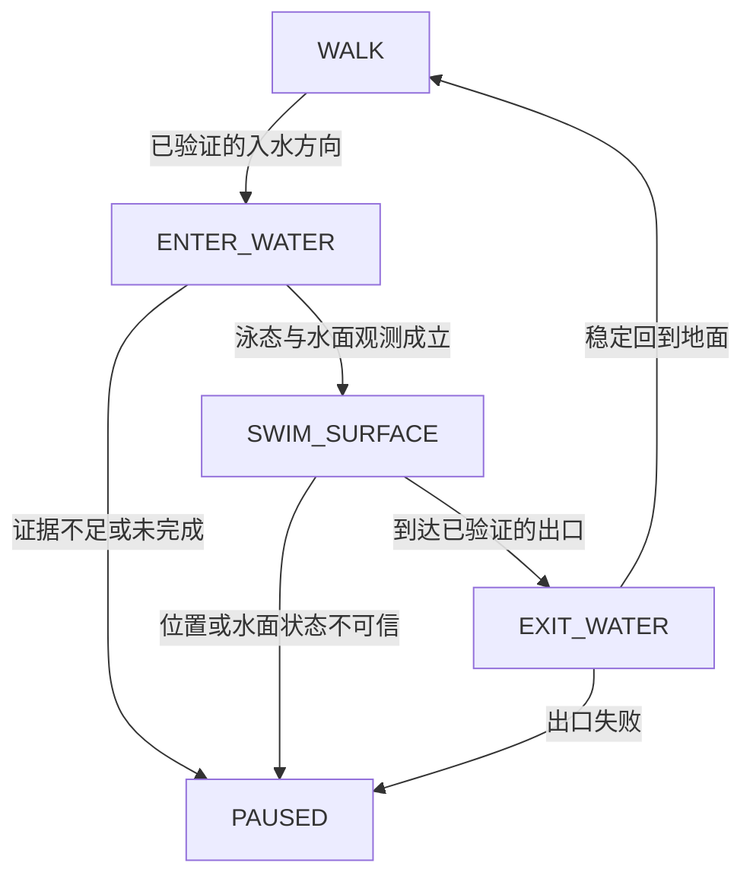

# 步行与水面游泳统一导航设计

日期：2026-10-29。状态：**设计方案，尚未实现或启用游泳**。本文基于已提供的固定生成源码、原生桥接接口、Python 控制器快照和三个桥附近案例。没有改动 DLL、瓦片、活动清单或输入设备，也没有生成新的水面连接。

## 结论与 V1 范围

建议把游泳作为具有独立数据、通行规则和执行状态的导航方式：**WALK + SWIM_SURFACE + 经验证的有向上下水转换**。V1 只规划水面游泳，不规划潜水、在水中三维绕障、跳桥落水、攀爬陡岸或运输工具。

默认策略为“优先可验证的步行道路与桥；允许游泳时，再评估有完整水面和上下水证据的候选”。步行搜索耗尽预算、路线过长被拒绝、道路引导不合适，都不等于“必须下水”，也不证明附近存在可用游泳通道。新出现的长候选被 `excessive_detour` 拒绝再触发节点池耗尽，不能由本设计直接修复或归因为桥、水面问题。

首先交付带模式标记的路线规划和预览。自动执行的启用条件另外核对：现有遥测是否确实报告泳态、是否能观察角色处在水面、设备和游戏绑定是否支持所需输入。**已经算出水面路线，不代表现有 Pico 控制器已经能执行。**

## 1. 当前数据和代码到底提供了什么

### 1.1 不能混淆三套编号

本地生成器的 `MMapDefines.h` 定义如下。`area`、导航 `flags`、原始液体类型编号不属于同一枚举；尤其不能把原始 `Magma=0x04` 与导航 `NAV_WATER=0x04` 混用。[L2][L5]

| 导航语义 | area | 导航 flags | 当前 GroundFilter |
|---|---:|---:|---|
| 普通地面 | 11 | 0x01 | 允许 |
| 陡地面 | 10 | 0x02 | 排除 |
| 水类表面 | 9 | 0x04 | 排除 |
| 岩浆或软泥 | 8 | 0x08 | 排除 |
| 道路 | 7 | 0x10 | 允许 |

Detour 的 `DT_POLYTYPE_GROUND` 是“普通面多边形”相对于 off-mesh 连接的结构类型。水类多边形也可以是此类型，因此这个名字不能证明表面是干地。实际类别由 area、flags 及其来源证据共同决定。[L9]

`NAV_WATER=4` 的准确含义是“本生成器把这个多边形输出为水类”。它不是可靠的水体物理证明，更不是“此处可安全游泳”的证明。原地图 0 / 50 / 34 已证明 ground 轮廓对应位置被最终多边形标成 water；地图 1 / 37 / 38 又独立证明 ground 与 water 混入同一个 region 后，桥顶及岸地被输出为 water。两案具体失真阶段的证据精度不同，不能统一宣称为某一次相同函数调用。[L18][L19]

### 1.2 `manifest.settings.water:false` 不等于生成器没有水

所审 manifest 声明 `kind=adrive-ground-navmesh`、`settings.water=false`。但 `NavMeshPack` 没有读取这个字段来删除液体或设置过滤器；实际只走地面由 DLL 中固定的 `include=0x11 / exclude=0x0e` 和控制器遇到 `SWIMMING` 停止来落实。[L1][L12][L13][L17]

生成器默认 `skipLiquid=false`，`usesLiquids()` 返回 `!m_skipLiquid`；目标生成命令没有使用 `--skipLiquid true`，真实 debug mesh 中也已经含有液体三角。瓦片头的 `usesLiquids` 同样只描述生成配置，不保证每个瓦片都有水、不证明分类正确，也不宣告运行时支持游泳。[L3][L4][L6][L19]

因此，现有 `water:false` 至多表达包当前声明不支持水域通行，不能作为液体几何不存在的证据。新清单应拆开三个维度：

```json
{
  "generation": {"liquid_geometry": "present", "liquid_semantics_version": 1},
  "planning": {"allowed_modes": ["WALK", "SWIM_SURFACE"]},
  "execution": {"verified_modes": ["WALK"]}
}
```

这是建议的新字段，不能直接把旧清单改成上述值来启用功能；每项必须有对应产物、接口和验收证据。

### 1.3 液体在生成过程中丢失的信息

本地 `TerrainBuilder` 从 ADT 读取液体类型、覆盖范围和液面高度，然后把 `Water` 与 `Ocean` 合成 area 9，把 `Magma` 与 `Slime` 合成 area 8；ADT `DarkWater` 分支同时丢弃地形和液面。WMO 液体从类型表转为同样的粗类别，而该分支没有与 ADT 分支等价的显式 `DarkWater` 排除判断。`LoadLiquid()` 只将 LiquidType 记录的 `SoundBank` 映射用于这个分类。[L3][L5][L6]

ADT 的“液体最低高度高于地形最高高度”分支会直接不保留该组地形三角。由此可知，最终 mmtile 不保证保留水底；不能总用“液面减下方最近 navmesh 高度”求水深。桥下、洞内、多层 WMO 还需要正确的垂直遮挡与所属液体空间，最近高度本身不够。[L3]

| 信息 | 现有 mmtile / ABI 状态 | V1 所需处理 |
|---|---|---|
| 水类面的 XY、表面高度、相邻多边形 | mmtile 通常有；当前公开 ABI 不返回类别 | 先暴露只读 surface 分类与来源 |
| 原始液体类型 ID、Water 与 Ocean 区分 | 被粗分类压缩，未进入现有 ABI | 从生成输入保留到 sidecar |
| Magma 与 Slime 区分 | 合并为一个危险类别 | V1 均禁止；保留原始 ID 供诊断 |
| DarkWater 与没有数据的区别 | ADT 可直接变成空白，不能由空白反推 | 显式危险/未知覆盖，不能自动补洞 |
| 真实水底、沿岸水深变化 | 可能在生成前已丢弃 | 保留 source collision/terrain 的底面或深度区间；未知写 null |
| 水上净空、浸入身体的碰撞空间 | 步行烘焙参数不能完整代表泳姿 | 按泳姿碰撞包络进行验证 |
| 岸边进入与离开的能力、方向 | 普通 poly link 没有此语义 | 单独生成、验证有向转换记录 |
| 疲劳区、特殊伤害、流动/动态危险 | 当前导航 API 没有完整数据 | 不把“普通 water”当全部安全；按已知覆盖限制范围 |
| 角色正在浮水还是潜水 | 没有专用现有字段 | 执行前核对现有可用观测；缺失时不声称已闭环 |

`MapDefines.h` 中确有服务器内部 `LiquidData.level/depth_level` 和 `ZLiquidStatus`。这些定义证明源体系能表达相关概念，不代表用户的 Forever 插件、DLL或 Pico 已可调用服务器液体查询。[L5]

## 2. 为什么只放开 `includeFlags | NAV_WATER` 不成立

1. **按当前代码甚至不会放行。** `exclude=0x0e` 含 0x04，Detour 要求同时满足“命中 include 且不命中 exclude”。只增加 include 位仍排除 water。[L1][L7]
2. **同时修改两组 mask 仍只解决标签过滤。** 它不会增加水深、泳姿净空、可上岸方向和危险覆盖，也不会修复缺失的桥面。
3. **已有两例 ground 被输出为 water。** 允许 area 9 会把某些桥面误称为泳段；按实际泳态执行时又可能一直等不到入水。规划成功不能用来证明分类正确。[L18][L19]
4. **存在局部真实的标签断面。** 西部荒野固定案例 816 的 31.5235 码面在 817/818 同高度被标为 water；上下可走面分别是 5 和 9 个多边形的孤岛。忽略类别能得到经过四个 water 多边形的局部拓扑通路，但原始几何尚不足，不能把它作为游泳路线。完整 46 瓦片图又确实存在一条约 6,982.67 码的地面绕路，所以也不能说此处全局绝对不通。[L20]
5. **岸线连接没有角色转换语义。** 原生跨 tile 连接使用边界几何和 walkableClimb 等条件，查询只跟随已存在的 poly links；它不判断走入水后能否重新上岸。允许水不能把单向落水变成双向坡岸。[L8]
6. **当前输出没有模式。** `ad_path` 返回点和引用，不返回 WALK/SWIM 或转换动作；`ad_surfaces` 只返回高度，还按 0.35 码合并接近高度的候选。若直接扩过滤器，地面/水面等高时的身份会丢失。[L1]
7. **执行会中断或误判。** runtime 和 controller 都把 SWIMMING 视为停止条件；高度推断只查询地面，把计划中的水面高度写入角色遥测将形成“用计划证明自身正确”的循环。[L11][L12][L13]

这些是当前源码和已复现案例的具体限制，不是要求将所有水域永久禁用。目标是建立能核验的水域导航能力。

## 3. 数据模型：表面、角色模式、转换分别表达

### 3.1 Surface 记录

建议保持已发布 mmtile 的二进制兼容，在新版本产物中加入经哈希绑定的语义 sidecar。离线生成时保留原始 liquid 和 solid 来源，不依赖最终 area 反向推断。

每个 surface 至少包含：

```text
surface_id: (map, tile_x, tile_y, tile_layer, polygon_index, tile_sha256)
native_ref: 仅当前加载上下文内有效，不作持久化身份
observed_nav_area / observed_nav_flags
physical_kind: SOLID | LIQUID_SURFACE | UNKNOWN
allowed_modes: WALK / SWIM_SURFACE；未知不得自动授权
source_kind: ADT | VMAP；原始几何/液体记录 ID 与 hash
height_model + vertical_uncertainty
liquid_type_id / liquid_type_flags / waterbody_id
bottom_height_range / depth_range / clearance / hazard_evidence
classification_evidence: source_verified | nav_tag_only | inconsistent
```

`observed_nav_area` 与 `physical_kind` 分开，才能表达“标签是 water，源几何是 solid”的已知错误，而不是静默按 water 执行。`inconsistent` 表面进入批量生成诊断与修复流程，在通过重新验证前不直接授权 WALK 或 SWIM。深度与净空要允许局部采样区间、已证明的下界和 `unknown`，不要填 0 伪装为浅水。开放深水不一定需要精确水底数值，但必须有足够水深或身体浸入空间的可靠证据。V1 水面图可来自同一个 navmesh 的可信子集，也可在纠正生成规则后分开生成；两者都要保留正确层身份和来源。

桥面、桥下液面和水底即使具有相同 XY，也必须是不同 surface。桥面 WALK 和其下 SWIM 之间不存在垂直直连；换模式只能通过已验证的岸边转换。浅水涉行先保留 WALK 模式并附 `wading=true`，只有角色能力与水深证据允许时才采用，不能把所有 area 9 自动视为可涉行。

### 3.2 生成时通用验证

通用修复对象应是生成规则和批量质量检查。保留液体语义、修正已证实的 solid 顶面标签与分区混类问题，建立“同一 region/最终 polygon 的分类应与原始覆盖一致”的检验，再扫描全包的可疑标签边界、陆地小孤岛与桥道路断口。两座已修桥作为回归样本；西部荒野及其他未知处保留待核标签，不能把所有 water 或孤岛统一重标地面。

对泳图增加海岸样本、同 XY 桥面/水面、深水/浅水、危险液体、跨 tile 水面接缝的回归集合。批量失败报告应按机制聚类，而不是每遇一个桥就增加坐标特例。本设计不要求用户再逐个提交单 tile。

## 4. 状态图与有向上下水验证

规划状态至少为 `(surface_id, movement_mode)`。如果策略限制转换次数、累计水程或其他资源，这些也应纳入搜索标签/支配关系，不能只按 polyRef 去重。



`ENTER_WATER` 与 `EXIT_WATER` 是执行阶段；搜索层对应有向转换边。普通 WALK→WALK 和 SWIM→SWIM 仅在相同模式的合法表面间沿真实邻接发生。

### 4.1 转换记录

```text
transition_id, source_surface_id, destination_surface_id
direction: WALK_TO_SWIM | SWIM_TO_WALK
shore_corridor / portal_width / approach_heading_range
source_contact_height / destination_water_height / height_uncertainty
depth_profile / slope_profile / step_profile / clearance_profile
required_actor_capabilities / prohibited_actions
validation_evidence_hashes / verified_profile_id / coverage_version
execution_observation_requirements / timeout_policy
```

一个岸口两个方向应分别验证并分别记录，不能用 `bidirectional=true` 自动推导。现有 `ad_block` 将 A→B 和 B→A 都视为禁止，新的转换阻断必须能按方向和模式记录，旧地面双向阻断兼容保留。[L1]

### 4.2 WALK→SWIM 验证

检查角色能沿有支撑且不穿碰撞体的坡岸前进到可信水域；沿通道的水平半径、上方净空及水下身体空间足够；没有必须跳落的高度断层或未验证跌落；目的水域有可执行的出口或明确以水中为终点的意图。跨越原本不存在的 navmesh gap 时，不自动造一根连接；若后续生成器可根据完整原始碰撞证明一个连续转换走廊，才把它作为有证据的新语义边构建。

### 4.3 SWIM→WALK 验证

独立验证上岸坡度、台阶、落脚宽度和身体碰撞。允许走下的边缘可能无法爬上，不能复用入水结论。V1 不假定自动跳跃可解决岸坎；需跳跃、攀爬或特殊动作的出口标为不支持。出口后必须接入可达的 WALK 分量，而不只是一个孤立岸边三角。

规划前验证的结果是几何与能力适配；运行时仍要确认角色确实完成转换。失败的转换不能在循环重规划中不断往返尝试，需记录该方向/模式的失效、原因和版本有效期。

## 5. Endpoint 与多层表面解析

**保留原始 XY，不把点挪去最近岸边。** 如果用户想选择附近岸口，应作为另一个明确目标/建议显示，不能隐藏投影移动。[L1]

新 surface 查询需要在同一 XY 返回多个完整候选：`surface_id, z_surface, area, flags, physical_kind, permitted_mode, component_id, evidence_level`。近高度去重只能合并同一物理表面上的重复三角，不能按 `abs(dz)<0.35` 合并地面与液面。已知高度的容差要随角色参考点和误差标记解释，不能把当前步行 resolver 的统一 ±2.5 码直接当作泳姿正确性阈值。[L1]

起点选择顺序：

1. 采用真实观测的当前模式。现有 `SWIMMING` 位经来源验证后可以说明正在游泳，但不能单独说明处于水面。
2. 如有经过核验的角色高度，结合模式、角色高度参考点和误差带筛选候选。
3. 高度未知时，只有“当前位置模式与表面候选均唯一”才能得到位置假设。其 `z_surface` 是几何预测，`z_actor_observed` 仍为 null，不能当作实际身体高度。
4. 桥上/桥下或多个液层仍歧义时返回 `AMBIGUOUS_SURFACE`，不由欲走路线反向选层。运行中保持上一已确认 surface 的连续性，只有合法转换可改变模式。

终点默认 WALK；明确选择水中目标或路线策略允许水中终止时才选 SWIM_SURFACE。桥上目标仍要到达桥上的 WALK 表面，不能以桥下相同 XY 的水面代替成功。返回多个目标候选时应显示类别与高度，不把最接近的一层自动说成用户选定层。

## 6. 原生 API 的增量设计

保留旧 `ad_create/ad_surfaces/ad_path` ABI 与地面行为。新能力使用单独版本接口，带 `struct_size`、`abi_version` 和 capability 查询，防止再出现新 Python 调用旧 DLL 的静默降级。

| 建议接口 | 目的与重要输出 |
|---|---|
| `ad_capabilities_v2` | ABI、支持模式、语义 sidecar 版本、节点/输出限制、校验状态 |
| `ad_query_surfaces_v2` | 保留原 XY；返回身份、类型、模式、表面高度、证据与候选数；溢出显式返回 |
| `ad_query_transition_v2` | 只读查询给定有向转换的几何、能力要求与验证状态 |
| `ad_plan_v2` | 输入显式 endpoint surface 或约束、策略、总预算、取消信号；输出有类型分段和诊断 |
| `ad_validate_route_v2` | 检查输出走廊、每次转换、模式一致性、终点身份与所有依赖版本 |

`ad_plan_v2` 可首先采用“上层模式/岸口图 + 模式内 Detour 查询”的方式。模式内查询始终只允许对应的已验证 surface 集合，跨模式只能使用已验证转换。上层边的代价可由缓存的模式内路径延迟计算，缓存 key 必须含瓦片/语义版本、角色能力、模式、方向及过滤策略。单个巨大 water 连通分量也需要空间分区或 portal 层级，不能把所有问题留给 65,535 节点池。

不要在当前只按 polyRef 的 Detour 搜索外简单修改一个可变 `current_mode`；同一个面不同模式、不同已用资源可能是不同状态。若将来直接实现多模式 native A*，需显式搜索状态并证明状态去重、预算、启发式与结果验证正确。

### 6.1 路线输出契约

除现有 points 外，每段至少返回：

```text
mode: WALK | ENTER_WATER | SWIM_SURFACE | EXIT_WATER
surface_ids / directed_transition_id / waterbody_id
points_world_north_west_surface_height
z_semantics: solid_contact | liquid_surface；不是观测到的角色 z
length_xy_yards / length_3d_yards / estimated_time_seconds
source_evidence / route_validation_status / executable_capabilities
start_surface_id / end_surface_id / component_ids
rejoin_road_edge_id / rejoin_road_progress（若由道路引导）
```

全路线再返回 `walk_search_status`、`fallback_reason`、`has_swim`、预算分项、遗漏数据和限制。`PARTIAL`、节点池耗尽、输出截断、危险未知、岸口未经验证须分别表达；只有完成所有段及目标身份验证后才能返回完整路线成功。

路线平滑不能跨越模式边界、跳过岸口或把桥面线段直接压成河面捷径。沿通道的水面高度也不能等价于玩家坐标；执行层有独立的观测字段。

## 7. 桥优先、游泳回退、代价和预算

### 7.1 默认选择策略

先在可信 WALK 图上沿道路/桥及允许的陆地连接规划。若有质量合格的步行路线，默认保留。是否允许较长陆地绕行应由明确产品策略决定，不能把一条错误的二维道路短参考线当成真实地面最短距离。

当用户启用游泳且数据和能力满足时，可评估 WALK→SWIM→WALK 候选，并在路线中明示水程、上下水点和回到道路的位置。若步行搜索结束于 `RESOURCE_LIMIT`，保持“步行可达性未判定”，即使找到已验证游泳方案，也不能说桥已证实不可走。单纯 `excessive_detour` 只表示候选不符合当前质量约束；与水面是否可用没有逻辑蕴含关系。

可设两种产品策略：`WALK_PREFERRED` 先接受符合约束的步行路线；`FASTEST_ALLOWED` 在所有被授权、被验证的模式内比较代价。默认前者；不把“高水代价”当成绝对桥优先保证，因为足够长的桥路仍会在标量代价比较中输给游泳。

### 7.2 代价

推荐上层图采用预计时间和明确惩罚：

```text
C = Σ(length(mode) / calibrated_speed(mode))
  + Σ(enter_or_exit_time)
  + λroad * reviewed_road_deviation
  + λswitch * number_of_transitions
  + λuncertainty * accepted_noncritical_uncertainty
```

危险液体、未验证上下岸、未知必需净空是硬约束，不用有限惩罚“买通”。泳速、泳态转向、入水/出水耗时必须校准，不能把步行常量复用。水面 V1 没有潜水路径，不需要通过虚构呼吸预算来宣布安全；若无法确认浮水，问题属于执行能力不足。

原生 Detour 固定启发式按距离计算。在不改其启发式时，应使用相对尺度保持最小移动成本不小于 1，例如先把最快合法速度归一化，不对“审核道路”随意使用小于 1 的倍率。时间尺度的上层 A* 可使用 `直线距离 / 最大可能速度` 的可采纳下界；拿不准时用 Dijkstra，不能把代价单位换成秒却保持原距离启发式。[L7][P1]

### 7.3 预算

总展开、每次节点池、加载字节、模式内路径次数和输出容量分别记账。当前 pool 固定 65,535，增加 plan_budget 或输出数组不扩 pool。[L1] 先做每模式连通分量和门户图剪枝，再进行局部查路，避免对已知不通的上下孤岛反复全图搜索。

合法分段可以使单次节点池复用，但每段必须真实连续、目标层正确、转换有证据，累计总预算仍受限。水路不是预算错误的掩盖办法。允许混合规划时预留模式搜索预算，并将 WALK 限额结束与拓扑不可达分开；不能将一个未知 WALK 结果改记为 `UNREACHABLE` 来触发游泳。

## 8. Pico 执行：当前已有能力与缺口

所审 Python 协议已经定义 `Flags.SWIMMING=8`，v2 位置帧含可选 z；但资料没有证明当前游戏插件在所有场景中可靠设置泳态，也没有现成的“水面/潜水/呼吸”字段。不能默认用户可获取新的游戏 API。[L10][L16]

两套输入路径必须区别：旧 `PicoClient.press` 每次一个键、20–200 ms；`LeaseClient.set_keys` 支持最多六个键、250 ms 租约及短动作，但当前 `Runtime._lease_send` 仍只从单一 `key` 构造一个键的 tuple。协议能表示组合键，不等于游戏绑定、固件握手和控制器已验证“前进+浮起”等动作。[L13][L14][L15]

现有 height resolver 对非零 raw z 标为 client；对零/缺失高度只在唯一地面上做几何推断。它的注释记录部分 Forever 流中 `UnitPosition` 高度恒为零，这不是全客户端普遍断言；零也可能是真实高度。新设计应保留原值与可信度，不把水面预测伪装为角色观测，更不能因为路线是水面就把 actor z 填成该水位。[L11]

### 8.1 模式相关的执行门禁

在 WALK 模式中，意外 `SWIMMING=true` 继续视为异常，停止并重新评估当前位置；不能全局删除这个保护。在合法 ENTER_WATER 走廊内等待泳态成立；到 SWIM_SURFACE 后按模式允许游泳，并继续保留位置新鲜度、窗口焦点、死亡、战斗、交通工具及设备租约等原有规则。

只有泳态仍不足以证明浮水。可用观测路径包括已核验的角色 z 与水面几何的关系，或已有、实测可靠的屏幕观测；当前资料不能承诺这些已可用。若只能得到 XY 和 SWIMMING，而无可靠的水面保持证据，先提供泳段规划/预览或受控试验，不把它升级成无人值守执行。

入水、出水条件应包含位置落入对应有向转换走廊、连续新鲜帧的模式变化、已验证表面/层身份及沿合法方向的移动。仅泳态关闭不能证明已成功上岸；还需验证稳定落在目标 WALK 表面并能继续前进，避免跳起、卡墙或上错层被误报成功。

### 8.2 控制量与校准

泳态需要独立的速度、转向和停止模型。V1 只在已验证为可以保持水面的场景使用水平航向控制；浮起键或其他保持动作必须以真实按键绑定和设备能力为前提。不要假设固定键必然有效，也不要在无可用垂直观测时循环盲按键来寻找出路。

执行每次只授权有限时长的动作/租约，观察位置、模式和水面状态；设备 ACK 只能确认设备/USB 状态，不能代替游戏中的移动效果。[L14][L15] 模式变化时清空步行速度滤波和未完成动作，重新校准/选择对应参数。上下水失败后冻结该方向转换，停止或选择已有证据支持的备选出口，不能反复折返跨越同一失败岸口。

## 9. 分阶段交付与验收

| 阶段 | 具体产物 | 可以声明的能力 |
|---|---|---|
| A：语义与批量诊断 | 数据版本拆分；原始 liquid/solid 来源 sidecar；水陆分量、错标与缺口报告 | 能区分标签、真实表面证据和未知数据 |
| B：只读 API | surface 候选、类别、组件、方向转换证据；旧 ABI 回归 | 能明确解释哪里缺少规划条件 |
| C：水面规划 | 双模式图、经验证岸口、typed segments、桥优先策略和预算诊断 | 能输出完整、可验证的混合模式路线；未保证执行 |
| D：设备与遥测验证 | 使用现有信号核对泳态、水面保持、组合键和租约；独立泳态校准 | 仅对实测满足能力的执行配置启用 |
| E：有限范围执行 | 开放水面与缓坡岸；方向单独验收；失败不循环重试 | 可执行该能力范围内的水面游泳 |

必要回归包括：两座已修桥仍保持 WALK；桥下水路不替代桥上终点；相同 XY 多层与近等高地面/液面不被合并；误标 water 只产生数据异常而不变成泳段；真实危险液体被拒绝；单向可下水不可上岸分别判定；无验证出口不进入；泳态缺失或 z 不可信不冒充完成；输出截断/65535 节点池/总预算独立报错；水陆跨 tile 接缝不产生虚构连接；泳段平滑不跨越岸口；上下水失败不会来回折返。

要达成通用能力，下一步应审定统一数据和接口契约，再批量生成/验证，不以继续增加个别桥坐标特例作为主路线。本文件不是活动配置，也没有授权或实际执行任何游戏输入。

## 10. 证据索引

本地证据是固定版本的一手源码或本轮可复现分析；它们是判断此项目实际行为的依据。每份文件的绝对路径、SHA-256 与符号说明保存在 `swimming_design.json` 的 `sources`。下列短标签与全文引用对应：

| 标签 | 本地证据与关键符号 |
|---|---|
| L1 | native `bridge.cpp`：GroundFilter、surfaces/resolve、ad_path/ad_block、pool 65535 |
| L2 | `MMapDefines.h`：NavArea、NavTerrainFlag、usesLiquids |
| L3 | `TerrainBuilder.cpp`：loadMap 液体分类/底面舍弃、transform WMO liquid |
| L4 | `TileBuilder.cpp`：solid/liquid raster、polyAreas/polyFlags、usesLiquids |
| L5 | `MapDefines.h`：原始液体类型、LiquidData、ZLiquidStatus |
| L6 | `PathGenerator.cpp`：skipLiquid 默认值、LoadLiquid/SoundBank |
| L7 | `DetourNavMeshQuery.cpp`：passFilter、getCost、sliced A* 启发式 |
| L8 | `DetourNavMesh.cpp`：findConnectingPolys、connectExtLinks |
| L9 | `DetourNavMesh.h`：dtPoly、DT_POLYTYPE_GROUND、dtLink |
| L10–L16 | `models/height/controller/runtime/lease/pico/telemetry.py` 固定快照 |
| L17 | `navmesh.py`：NavMeshPack、Surface/Segment 转换 |
| L18 | 地图 0 / 50 / 34 已验证桥生成报告 |
| L19 | 地图 1 / 37 / 38 独立 source_analysis 报告 |
| L20 | 西部荒野完整 46 tile 图与多层表面证据 |

公开一手资料用于核对通用 API 语义，不替代本地 fork 的固定源码：

- **P1**：[Recast Navigation — dtQueryFilter](https://recastnav.com/classdtQueryFilter.html)：include/exclude 同时命中时排除，区域代价与启发式约束。
- **P2**：[TrinityCore — TerrainBuilder.cpp](https://main.trinitycore.net/df/d09/terrainbuilder_8cpp_source)：公开上游同样可见液体粗分类及 DarkWater 分支。具体本地行为仍以 L3 为准。
- **P3**：[Recast Navigation — dtOffMeshConnection](https://recastnav.com/structdtOffMeshConnection.html)：它是端点连接描述，不自带游戏泳态、岸口动作或可执行性证明；本方案不依靠任意补连。

公开资料访问日期为 2026-10-29。全文未调用新的游戏 API、未调整已运行导航策略。
